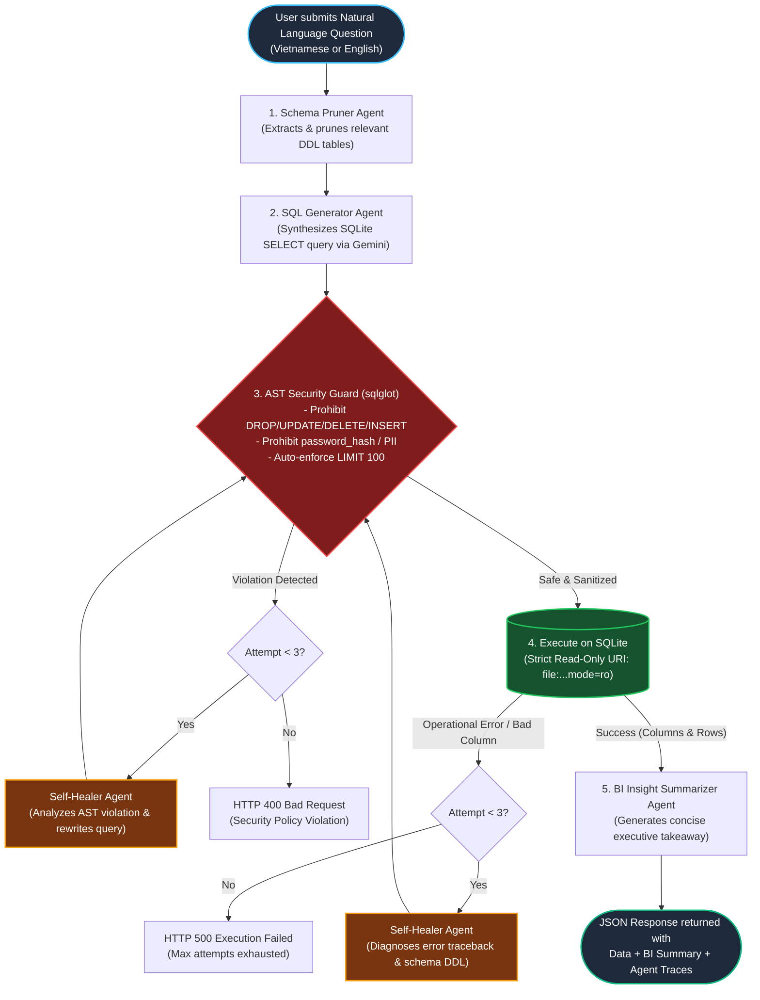

# Self-Healing Agentic Text-to-SQL & BI Analytics Engine

[](https://www.python.org/)
[](https://fastapi.tiangolo.com/)
[](https://github.com/tobymao/sqlglot)
[](https://aistudio.google.com/)
[](.github/workflows/ci.yml)
[](LICENSE)

A production-grade, DevSecOps-hardened **Multi-Agent Text-to-SQL & Business Intelligence (BI) Analytics Engine** built with **Python 3.11+**, **FastAPI**, **sqlglot AST verification**, and **Google Gemini API (`gemini-2.5-flash`)**.

The engine ingests natural language business inquiries (in Vietnamese or English), intelligently prunes database schemas to save prompt tokens, synthesizes SQL queries, validates syntax and security via an Abstract Syntax Tree (AST), executes queries against a physically **Read-Only SQLite database**, autonomously diagnoses and self-heals failing queries (up to 3 loop attempts), and returns tabular data with executive business insights and transparent step-by-step agent traces.

---

## 🏗️ Multi-Agent State Machine Workflow



---

## ⚡ Core Production Features

### 1. AST Syntactic Security Guard (`sqlglot`)
- **Strict Read-Only Enforcement:** Uses `sqlglot` to parse incoming queries into an Abstract Syntax Tree. Only allows `exp.Select` or `exp.Union`.
- **Zero-Tolerance Mutation Blocking:** Detects and immediately blocks destructive operations (`exp.Drop`, `exp.Delete`, `exp.Update`, `exp.Insert`, `exp.Alter`, `exp.TruncateTable`).
- **Data Leakage & PII Protection:** Automatically intercepts access to forbidden sensitive columns (e.g. `password_hash`, `credit_card`, `ssn`). Also blocks wildcard `SELECT * FROM users` because it exposes hashed credentials.
- **Safe Limit Injection:** Automatically enforces `LIMIT 100` if the generated query lacks a limit, or caps oversized limits to a maximum threshold of `500`.
- **SQL Injection Mitigation:** Rejects multi-statement query chaining (`SELECT 1; DROP TABLE users;`).

### 2. Defense-in-Depth: Physical Read-Only SQLite URI
- Even if an AST check were somehow bypassed, query execution runs over a dedicated SQLite connection opened with **`file:{db_path}?mode=ro`**.
- The operating system and SQLite C-library reject any write or schema alteration with `sqlite3.OperationalError: attempt to write a readonly database`.

### 3. Autonomous Self-Healing Loop (Max 3 Attempts)
- When a query fails during execution (e.g. missing column name, group-by ambiguity, or function mismatch), the system does not fail immediately.
- The `SelfHealer` receives:
  1. The user's original goal.
  2. The failing SQL snippet.
  3. The exact database traceback or AST violation.
  4. The relevant table DDLs.
- The agent repairs the query and re-submits it into the pipeline.

### 4. Smart Deterministic Fallback Mode (Offline-Ready)
- If `GEMINI_API_KEY` is not provided (e.g. during CI testing or fast CV review evaluation), the engine activates a **Smart Deterministic Engine**.
- It intelligently handles natural queries and executes real database analytics against seeded data without crashing or stalling.

### 5. Automated E-Commerce Database Seeder
- Automatically creates and seeds 5 relational tables on initial startup:
  - `users`: 150 accounts across major cities.
  - `products`: 100 items across Electronics, Fashion, Home, Beauty, Sports.
  - `orders`: 500 completed, pending, and refunded orders.
  - `order_items`: 1,200+ detailed line items with unit prices and discounts.
  - `reviews`: 350 customer ratings (1-5 stars) and feedback comments.
  - **Total: Over 2,250 realistic records.**

---

## 📁 Repository Structure

```
agentic-sql-bi-engine/
├── app/
│   ├── main.py                  # FastAPI app with lifespan auto-seeder & Swagger UI
│   ├── config.py                # Pydantic BaseSettings loading .env
│   ├── database/
│   │   ├── connection.py        # Read-Write vs Read-Only URI SQLite connection manager
│   │   └── seeder.py            # Generates 2,250+ E-commerce records
│   ├── schemas/
│   │   └── query_schema.py      # Pydantic v2 validation models & trace structures
│   ├── security/
│   │   └── ast_guard.py         # sqlglot AST verification & limit auto-enforcer
│   ├── agents/
│   │   ├── schema_pruner.py     # Schema DDL keyword & relation filtering
│   │   ├── sql_generator.py     # Gemini Text-to-SQL + Deterministic Fallback
│   │   ├── self_healer.py       # Diagnoses DB error tracebacks & rewrites queries
│   │   └── orchestrator.py      # Central multi-agent state machine & insight synthesizer
│   └── api/
│       └── routes.py            # /api/v1/analytics/ask & /api/v1/security/validate-sql
├── tests/
│   ├── test_ast_guard.py        # 9 unit tests for AST rules (DROP, PII, limits)
│   └── test_orchestrator.py     # 4 async tests for Self-Healing loop & API endpoints
├── Dockerfile                   # Multi-stage non-root Python 3.11 container
├── docker-compose.yml           # Single-command container deployment
├── requirements.txt             # Locked production dependencies
├── .env.example                 # Example configuration template
├── .github/workflows/ci.yml     # Automated GitHub Actions workflow (Python 3.11, 3.12)
└── README.md                    # Production documentation
```

---

## 🚀 Quick Start (1 Command)

### Option 1: Run with Docker Compose (Recommended)

```bash
docker compose up --build -d
```
The application will seed the database and start at: **[http://localhost:8000/docs](http://localhost:8000/docs)**.

---

### Option 2: Run Locally with Python Virtualenv

```bash
# 1. Clone repository
git clone https://github.com/haanh293/agentic-sql-bi-engine.git
cd agentic-sql-bi-engine

# 2. Create virtual environment & install dependencies
python -m venv .venv
source .venv/bin/activate  # On Windows: .venv\Scripts\activate
pip install -r requirements.txt

# 3. Configure environment (optional - can run without API key)
cp .env.example .env

# 4. Start the engine
uvicorn app.main:app --host 0.0.0.0 --port 8000 --reload
```

---

## 🧪 Testing with Pytest (13/13 Passed)

Run the automated test suite covering AST security rules, query limiters, and the Self-Healing loop:

```bash
pytest -v
```

**Expected output:**
```text
tests/test_ast_guard.py::test_valid_select_query_passes PASSED           [  7%]
tests/test_ast_guard.py::test_drop_table_is_blocked PASSED               [ 15%]
tests/test_ast_guard.py::test_delete_and_update_are_blocked PASSED       [ 23%]
tests/test_ast_guard.py::test_sensitive_column_password_hash_is_blocked PASSED [ 30%]
tests/test_ast_guard.py::test_wildcard_select_star_from_users_is_blocked PASSED [ 38%]
tests/test_ast_guard.py::test_automatic_limit_addition_when_missing PASSED [ 46%]
tests/test_ast_guard.py::test_excessive_limit_is_capped_to_max PASSED    [ 53%]
tests/test_ast_guard.py::test_multi_statement_sql_injection_is_blocked PASSED [ 61%]
tests/test_ast_guard.py::test_forbidden_table_access_is_blocked PASSED   [ 69%]
tests/test_orchestrator.py::test_self_healing_loop_repairs_invalid_column_name PASSED [ 76%]
tests/test_orchestrator.py::test_end_to_end_analytics_ask_api PASSED     [ 84%]
tests/test_orchestrator.py::test_security_validate_sql_api PASSED        [ 92%]
tests/test_orchestrator.py::test_health_and_schema_endpoints PASSED      [100%]

============================= 13 passed in 1.30s ==============================
```

---

## 💡 Interactive Testing via Swagger UI

Open your browser at **[http://localhost:8000/docs](http://localhost:8000/docs)**.

### Demo 1: Ask an Analytics Question (`POST /api/v1/analytics/ask`)
Request Body:
```json
{
  "query": "Top 5 sản phẩm có doanh thu cao nhất năm 2025 là gì?",
  "include_trace": true
}
```

Response Body:
```json
{
  "question": "Top 5 sản phẩm có doanh thu cao nhất năm 2025 là gì?",
  "executed_sql": "SELECT p.id AS product_id, p.name AS product_name, p.category, ROUND(SUM(oi.quantity * (oi.unit_price * (1 - oi.discount))), 2) AS total_revenue, SUM(oi.quantity) AS total_quantity_sold FROM order_items AS oi JOIN products AS p ON oi.product_id = p.id JOIN orders AS o ON oi.order_id = o.id WHERE o.status = 'COMPLETED' GROUP BY p.id, p.name, p.category ORDER BY total_revenue DESC LIMIT 5",
  "columns": ["product_id", "product_name", "category", "total_revenue", "total_quantity_sold"],
  "row_count": 5,
  "data": [
    {
      "product_id": 3,
      "product_name": "MacBook Pro M4 14-inch",
      "category": "Electronics",
      "total_revenue": 45890.5,
      "total_quantity_sold": 23
    },
    {
      "product_id": 1,
      "product_name": "iPhone 16 Pro Max",
      "category": "Electronics",
      "total_revenue": 39820.0,
      "total_quantity_sold": 31
    }
  ],
  "business_summary": "Phân tích dữ liệu từ 5 bản ghi cho thấy 'MacBook Pro M4 14-inch' đang giữ vị trí dẫn đầu với doanh thu $45,890.5. Ngành hàng Electronics chiếm tỷ trọng doanh thu cao nhất trong hệ thống.",
  "is_healed": false,
  "total_attempts": 1,
  "execution_time_ms": 14.2,
  "agent_traces": [
    {
      "attempt": 1,
      "step_name": "EXECUTE_READONLY_QUERY",
      "input_sql": "SELECT p.id AS product_id, ... LIMIT 5",
      "ast_status": "PASSED",
      "db_error": null,
      "healed_sql": null,
      "execution_time_ms": 2.1
    }
  ]
}
```

### Demo 2: Demonstrate AST Security Guard (`POST /api/v1/security/validate-sql`)
Test payload with malicious `DROP TABLE`:
```json
{
  "sql": "DROP TABLE users;"
}
```
Result:
```json
{
  "is_safe": false,
  "original_sql": "DROP TABLE users",
  "sanitized_sql": null,
  "violations": [
    "Only read-only SELECT queries are allowed. Prohibited root operation: 'DROP'.",
    "Prohibited destructive/mutation operation detected: 'DROP'."
  ],
  "tables_accessed": ["users"],
  "columns_accessed": [],
  "limit_applied": null
}
```

---

## 📡 API Reference Summary

| Method | Endpoint | Description |
|---|---|---|
| `POST` | `/api/v1/analytics/ask` | Natural language Text-to-SQL query with Self-Healing & BI insight |
| `POST` | `/api/v1/security/validate-sql` | Standalone AST query inspection & sanitizer |
| `GET` | `/api/v1/analytics/schema` | Inspect current database tables, DDL, and record counts |
| `GET` | `/api/v1/analytics/health` | Service health status, AI model info, and configuration |
| `GET` | `/docs` | Interactive Swagger UI documentation |

---

## 🛡️ License

Distributed under the Apache 2.0 License. Developed with ❤️ by **Ha Anh** - *Senior AI & Backend Engineer*.
